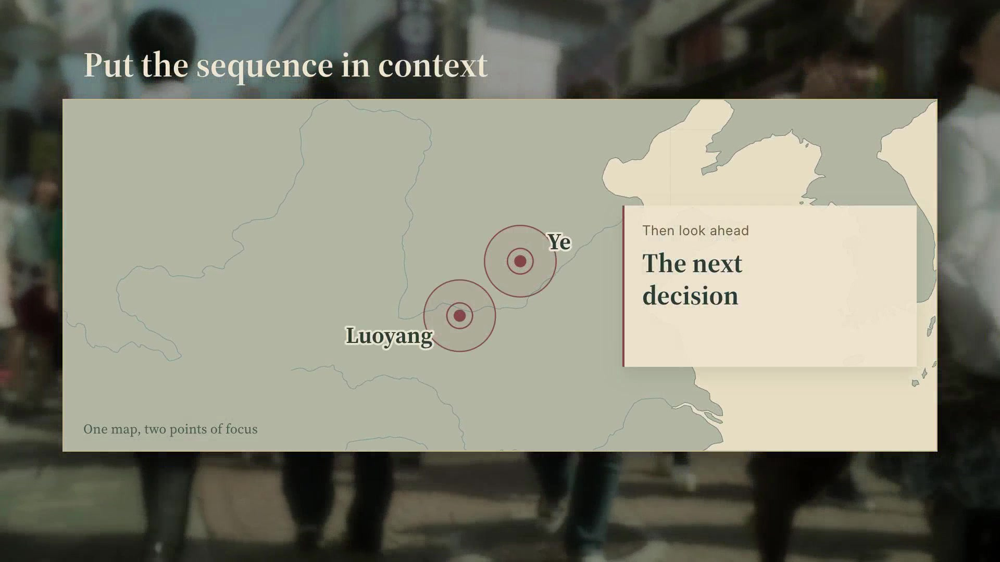
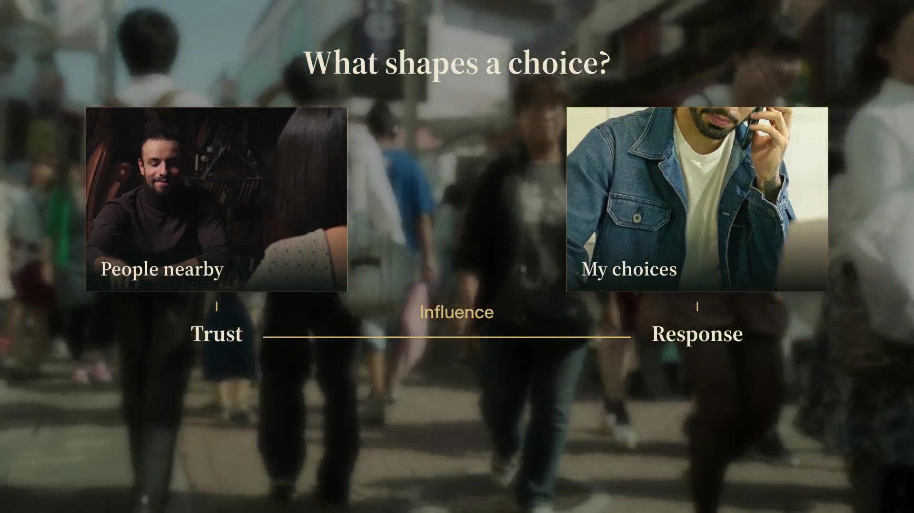

<div align="center">

**English** | [简体中文](README.zh-CN.md)


# Vibe Knowledge Video

**A topic, a narrator, and a film worth watching.**

[](LICENSE)
[](https://learn.chatgpt.com/docs/build-skills)
[](references/language.md)
[](https://www.feicaiclub.cn)

A single Codex skill for researching, writing, narrating, editing, and reviewing explainer films.<br>
Built from finished short films and the revisions that made them work.

[Install](#install-in-codex) · [See the system](#see-the-system) · [How it works](#how-it-works) · [Lazy Studio](#lazy-studio) · [About](#about-the-author)

</div>

## Install in Codex

**Copy this into a Codex chat and send it:**

```text
$skill-installer Install https://github.com/feicaiclub/vibe-knowledge-video from the repository root (path: .), with the skill name vibe-knowledge-video.
```

Codex handles the installation. The skill is available on your next turn; if it does not appear, restart Codex. This uses Codex's [built-in Skill Installer](https://learn.chatgpt.com/docs/build-skills#install-curated-skills-for-local-use).

Then start with something like:

```text
$vibe-knowledge-video Make an English explainer about why we rationalize decisions we have already made. Build it around a concrete story. Use the series narrator and visual system, with footage, music, and graphics that follow the argument. Deliver a finished film and open it in Lazy Studio for review.
```

You can also ask for topic ideas, a script, or a revision to an existing film. The scope follows your request.

Dependencies are checked and installed **when needed**, outside the skill folder. Installing this skill does not bundle or preinstall the speech models. If setup fails on your machine, Codex diagnoses the cause and works through compatible alternatives, explaining meaningful differences in the result.

## See the system

The package includes **21 visual designs, each with English and Chinese layout previews**, an editable renderer, and a visual handbook.

<table>
<tr>
<td width="50%"><br>Maps that explain places and relationships</td>
<td width="50%"><br>Evidence and context, organized around the narration</td>
</tr>
<tr>
<td width="50%"><br>Connections revealed in a deliberate order</td>
<td width="50%"><br>Typography with space, hierarchy, and restraint</td>
</tr>
</table>

- Open the [visual handbook](references/visual-handbook.html) locally after installation to view all 42 still previews and the layout and motion guidance. GitHub displays its HTML source; download or open the installed file to use the handbook.
- Listen to the [approved English narrator sample](assets/voice/english-pilot.wav) or the [Mandarin voice reference](assets/voice/reference.wav).
- Read the [shared component source](assets/packaging/src/README.md) and [renderer guide](references/packaging.md).

The examples show a reusable visual language. Choose, adapt, or create graphics to explain each topic. A film does not need every component.

## How it works

| Stage | What Codex does |
| --- | --- |
| Research and writing | Finds evidence, builds a story, and gives the viewer a clearer way to understand the question. |
| Shot planning | Matches footage to the narration, checks people and events, and plans cuts, music changes, and graphic reveals. |
| Narration | Uses the approved Qwen3-TTS D reference and body-v1 finishing. Speaker identity stays consistent; emotion and phrasing follow the story. |
| Editing and graphics | Calls the actual shared renderer for maps, cards, diagrams, and type. Uses each original moving shot once in a production film. |
| Sound | Places distinct music cues, transitions, and effects around the narrative while keeping speech clear. |
| Review and revision | Checks the exported film, preserves approved work, reads your exact-frame notes, and delivers a new version. |

The workflow keeps the quality floor established by the original films while leaving room for better writing, editing, and design. It works in English and Chinese; the skill and technical documentation are written in English.

## Lazy Studio


Lazy Studio is a local review room, included in the skill:

1. Play or pause the film. Use the arrow keys to step through frames.
2. Press **M**, write a comment, and press **Enter**.
3. The note, exact frame, version, and screenshot are saved in the film project's `review/feedback.md` and related files.
4. Return to the original Codex chat and say, **“My notes are ready. Read the feedback and make the changes.”**

Two versions can play side by side. Notes stay on your machine. The current integration uses local files: it does not pretend to attach feedback to the Codex chat automatically.

## What's included

```text
vibe-knowledge-video/
├── SKILL.md                  One skill: the production workflow
├── references/               Visual handbook, production guides, verification
├── scripts/                  Setup, voice, transcription, editing, review tools
├── assets/
│   ├── packaging/            Renderer source, fonts, maps, bilingual previews
│   ├── voice/                Fixed reference, English pilot, profiles, pronunciation
│   └── lazy-studio/          Review interface
└── package-manifest.json     File integrity checks
```

No extra `CLAUDE.md`, `AGENTS.md`, model weights, virtual environments, or personal API keys are required inside the package. New film projects and generated media live outside it.

## Dependencies and practical limits

The default stack preserves the versions used in the approved workflow: **Qwen3-TTS via MLX Audio, MLX Whisper large-v3, HyperFrames, FFmpeg, and the shared visual renderer**. Exact versions and model revisions are in [runtime-lock.json](scripts/runtime-lock.json).

The original voice and transcription implementations were exercised on Apple Silicon Macs. Other machines may need a compatible implementation. That adaptation happens when the skill is used; this release does not claim identical output across untested backends. The [runtime guide](references/runtime.md) explains how Codex handles missing dependencies and failed installations.

Local model downloads can be large, and synthesis speed depends on the machine. External music and effects services are optional and use your own account and credits. No credentials are included.

The handbook includes still previews; pre-rendered demo videos are not bundled. Raw third-party demo clips are not redistributed. You can make a new film without those clips; to rebuild the sample catalogs, provide your own licensed footage with `catalog --media-dir`. See [demo media](assets/packaging/demo-media/README.md).

Transcription helps find missing or repeated words and establish timing. It does not certify pronunciation or naturalness. The English pilot was approved through user listening. The approved voice settings and sample hashes are recorded in the [voice profile](assets/voice/profile.json).

## Contributing

If a command fails, open an [issue](https://github.com/feicaiclub/vibe-knowledge-video/issues) with your OS, hardware, the command or step, and a redacted error message. Do not include API keys or private source footage.

For a visual change, include a short example that shows the full entrance, reading order, hold, and exit. Update the shared component and handbook together. For other changes, run `python3 scripts/validate_package.py --manifest`, then `python3 scripts/validate_package.py --verify-manifest` before submitting a pull request. Package CI checks files and references without downloading production models.

## Credits and license

Original code and documentation: [MIT](LICENSE). Fonts keep their SIL Open Font Licenses; map geometry comes from Natural Earth. Third-party footage visible in demonstrations is not relicensed under MIT. See [third-party notices](THIRD_PARTY_NOTICES.md).

The workflow uses Qwen3-TTS, MLX Audio, MLX Whisper, HyperFrames, GSAP, FFmpeg, and Pedalboard. Lazy Studio builds on FEICAI's existing review tools and UI kit.

## About the author

**Feicai (废才)** is the founder of **Feicai Club (废才俱乐部)**, an AI builder and educator working with agents, software, and filmmaking. These workflows are developed through real projects, then the reusable parts are shared as open source.

- Author of *驱动 AI 提示词：指令入门与场景应用* (Tsinghua University Press).
- Creator of the 毒舌产品经理 and Seedance 分镜师 series.
- More projects: [Ad Storyboarder](https://github.com/feicaiclub/ad-storyboarder), [previz](https://github.com/feicaiclub/previz), [video-spec-builder](https://github.com/feicaiclub/video-spec-builder), and the [DeepSeek Harness whitepaper](https://github.com/feicaiclub/deepseek-harness-whitepaper).

[Website and community](https://www.feicaiclub.cn) · [YouTube](https://www.youtube.com/@feicaiclub) · [Bilibili](https://space.bilibili.com/3546566589679687) · [X](https://x.com/zhu185178)


[](https://www.feicaiclub.cn)
