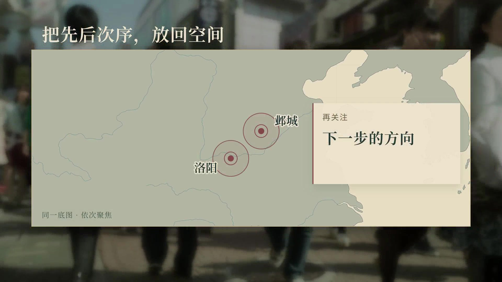
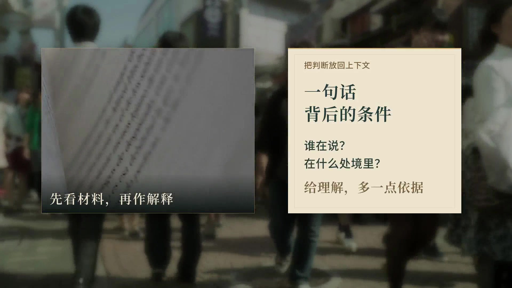
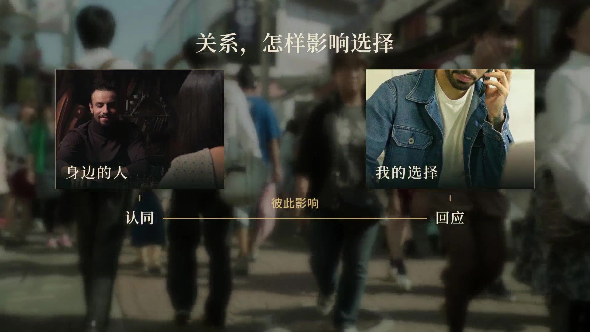

<div align="center">

[English](README.md) | **简体中文**


# Vibe 知识视频

**从一个选题，做到一条值得看完的知识短片。**

[](LICENSE)
[](https://learn.chatgpt.com/docs/build-skills)
[](references/language.md)
[](https://www.feicaiclub.cn)

把调研、写稿、分镜、旁白、配乐、包装、剪辑和逐帧返修，沉淀成一个 Codex Skill。<br>
来自我们反复制作、修改并定稿的知识短片。

[安装](#在-codex-里安装) · [看效果](#看效果) · [怎么工作](#怎么工作) · [Lazy Studio](#lazy-studio-逐帧审片) · [关于作者](#关于作者)

</div>

## 在 Codex 里安装

**复制下面这段，粘进 Codex 聊天框发送：**

```text
$skill-installer 从 https://github.com/feicaiclub/vibe-knowledge-video 安装仓库根目录（path: .）的 Skill，安装名称为 vibe-knowledge-video。
```

Codex 会完成安装，下一轮对话即可使用；如果没有出现，重启 Codex 后再试。这里使用的是 Codex 自带的 [Skill Installer](https://learn.chatgpt.com/docs/build-skills#install-curated-skills-for-local-use)。

然后直接告诉它你想做什么，例如：

```text
$vibe-knowledge-video 做一条讲“为什么人会合理化自己已经做出的选择”的中文知识短片。用一个具体故事讲清楚，有转折、有反思。沿用系列声线和视觉包装，让素材、音乐和图解跟着内容推进。完成后给我成片，并打开 Lazy Studio 审片。
```

也可以只要选题、只打磨稿子，或者修改已有视频。按你这次需要的范围来做。

依赖在**实际使用时**检查、按需安装，安装位置在 Skill 外面。安装 Skill 本身不会把语音模型和运行环境一起塞进来。如果对方电脑安装失败，Codex 会说明原因，先排查修复，再寻找适合那台机器的兼容方案，并说明对效果的影响。

## 看效果

包内有 **21 种视觉设计，每种都有中文和英文排版预览图**，以及可编辑源码和通用视觉手册。

<table>
<tr>
<td width="50%"><br>地图：把地点与关系讲清楚</td>
<td width="50%"><br>证据：让材料和解释各就其位</td>
</tr>
<tr>
<td width="50%"><br>关系：主体、连接、结论依次出现</td>
<td width="50%"><br>文字：用版式和节奏承接观点</td>
</tr>
</table>

- 安装后，在本地打开[视觉包装手册](references/visual-handbook.html)，查看 42 张中英文预览图，以及排版和动效顺序说明。GitHub 会展示 HTML 源码，需要下载或打开已安装的文件来浏览手册。
- 试听[已认可的英文旁白样音](assets/voice/english-pilot.wav)和[中文声线参考](assets/voice/reference.wav)。
- 查看[组件源码](assets/packaging/src/README.md)与[组件调用说明](references/packaging.md)。

手册提供的是一套可复用的视觉语言。每期根据内容选择、调整或新建组件，不要求所有视频使用同样的开头和版式。

## 怎么工作

| 环节 | Codex 做什么 |
| --- | --- |
| 调研与写稿 | 找依据，用故事、细节和转折展开，让观众听完有更清晰的判断。 |
| 素材与分镜 | 主动寻找适合的影视或实拍素材，核对人物、事件和画面语义，安排镜头、配乐和包装。 |
| 旁白 | 使用固定的 Qwen3-TTS D 声线参考和 body-v1 后期；音色稳定，情绪、停连和表达跟随内容。 |
| 剪辑与包装 | 实际调用共享组件源码，把地图、卡片、图解和文字按讲解顺序组织起来；成片中的同一原始运动镜头只用一次。 |
| 音乐与音效 | 根据叙事换音乐、做衔接、安排重音与留白，保证旁白清楚。 |
| 自审与返修 | 检查导出的成片，读取你的逐帧反馈，保留已认可的部分，修改后交新版。 |

这套工作流保留已经打磨好的质量底线，给写作、设计和剪辑留下发挥空间。支持中文、英文视频；Skill 和技术文档统一使用英文。

## Lazy Studio 逐帧审片


Lazy Studio 随包提供，运行在本机。操作只有几步：

1. 播放、暂停，用左右方向键逐帧查看。
2. 按 **M**，输入这帧的修改意见，按 **Enter** 保存。
3. 意见、精确帧号、版本和截图存进该视频项目的 `review/feedback.md` 及相关文件。
4. 回到原来的 Codex 对话，说一句：**“我标记好了，去读反馈并修改。”**

两版视频可以左右对比。反馈保存在本地，当前通过文件与 Codex 对接，不会声称已经自动作为附件发进聊天框。

## 里面有什么

```text
vibe-knowledge-video/
├── SKILL.md                  唯一的 Skill，整体制作流程
├── references/               视觉手册、制作说明、检查记录
├── scripts/                  依赖准备、配音、转写、剪辑与审片工具
├── assets/
│   ├── packaging/            包装源码、字体、地图、中英文预览
│   ├── voice/                固定参考声线、英文样音、配置、读音词典
│   └── lazy-studio/          审片界面
└── package-manifest.json     文件完整性校验
```

只有一个 Skill，不需要额外的 `CLAUDE.md` 或 `AGENTS.md`。运行环境、模型权重、个人 API Key 和新视频项目都放在包外。

## 依赖与实际边界

默认沿用定稿流程里的 **Qwen3-TTS / MLX Audio、MLX Whisper large-v3、HyperFrames、FFmpeg 和共享视觉组件**。具体版本与模型快照在 [runtime-lock.json](scripts/runtime-lock.json)。

原来的旁白和转写实测环境是 Apple Silicon Mac。其他机器可能需要兼容实现，由 Codex 在实际使用时排查适配，不把未经验证的替代方案说成效果完全一致。[依赖说明](references/runtime.md)里写了这套处理原则。

本地模型首次下载可能较大，生成速度取决于机器。音乐和音效可以使用外部服务，需要使用者自己的账号与额度，包内没有凭据。

手册保留静态预览图，预渲染的演示视频不打包。第三方原始样例素材不随开源仓库分发；制作新片不依赖这些旧素材。重新渲染示例集时，用 `catalog --media-dir` 指定自己有权使用的素材，详见[演示素材说明](assets/packaging/demo-media/README.md)。

转写用来检查漏读、重复和时间，不能替代对音色、发音和自然度的试听。英文样音已经过用户试听认可。已认可的声线设置和样音哈希，保存在[声线配置](assets/voice/profile.json)。

## 反馈与贡献

遇到问题可以提 [issue](https://github.com/feicaiclub/vibe-knowledge-video/issues)，写明系统、硬件、出错的命令或步骤，附上去掉敏感信息的报错。不要上传 API Key 或私人素材。

改视觉组件时，请附上能看清入场、阅读顺序、停留和退场的短示例，源码和手册一起更新。提交前运行 `python3 scripts/validate_package.py --manifest` 和 `python3 scripts/validate_package.py --verify-manifest`。仓库 CI 只检查包文件和引用，不下载制作模型。

## 致谢与许可证

原创代码与文档采用 [MIT](LICENSE)。字体保留 SIL Open Font License，地图数据来自 Natural Earth。演示里出现的第三方画面不随 MIT 重新授权，详见[第三方许可说明](THIRD_PARTY_NOTICES.md)。

感谢 Qwen3-TTS、MLX Audio、MLX Whisper、HyperFrames、GSAP、FFmpeg 和 Pedalboard。Lazy Studio 沿用废才既有的审片工具和 UI kit。

## 关于作者

**废才** — 废才俱乐部主理人，AI Builder 与知识分享者，专注 AI Agent、编程和影视创作。工作流先在实际项目里跑通，再把可复用的部分整理开源。

- 著有《驱动 AI 提示词：指令入门与场景应用》（清华大学出版社）。
- 毒舌产品经理系列、Seedance 分镜师系列的开发者。
- 其他开源作品：[广告分镜师](https://github.com/feicaiclub/ad-storyboarder)、[previz](https://github.com/feicaiclub/previz)、[video-spec-builder](https://github.com/feicaiclub/video-spec-builder)、[DeepSeek Harness 白皮书](https://github.com/feicaiclub/deepseek-harness-whitepaper)。

[官网与社区](https://www.feicaiclub.cn) · [YouTube](https://www.youtube.com/@feicaiclub) · [B站](https://space.bilibili.com/3546566589679687) · [X](https://x.com/zhu185178)


[](https://www.feicaiclub.cn)
