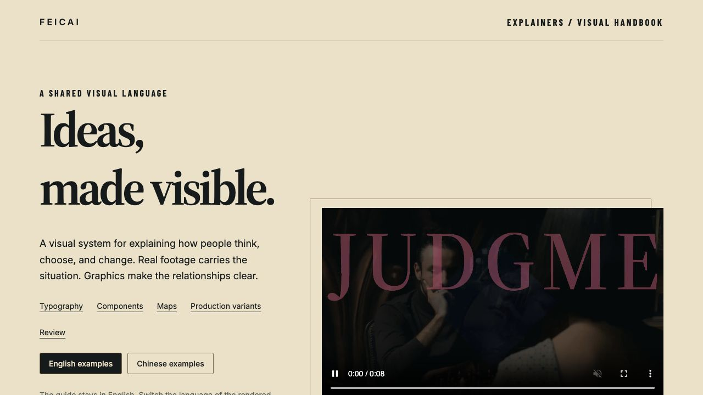
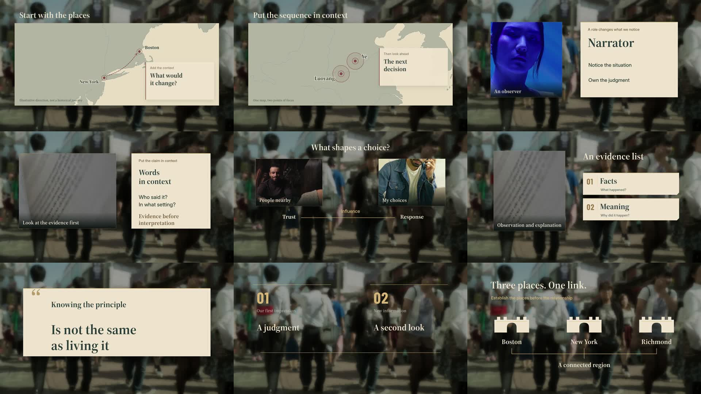
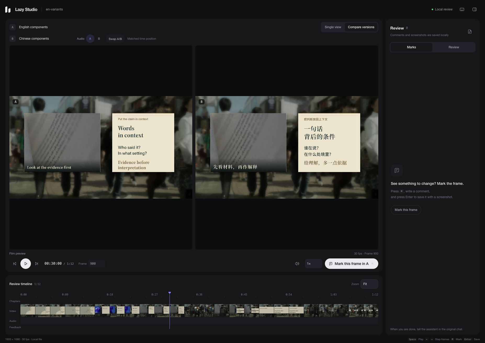

# Package verification

Updated October 23, 2026. This is one Skill with English documentation and an English review interface. It supports English and Chinese film production. Runtime dependencies remain outside the Skill.

```text
knowledge-easy/
├── SKILL.md
├── references/          Guides, visual handbook, and verification notes
├── scripts/             Runtime setup, production tools, and review server
├── assets/
│   ├── packaging/       Shared source, fonts, maps, and localized examples
│   ├── voice/           Fixed reference, profiles, and pronunciation notes
│   └── lazy-studio/     English review interface
└── package-manifest.json
```

## Production and visual acceptance · renderer 1.4.0

All twelve base designs now run through the normal production entry with explicit content/media slots and semantic cues. Scenes can compose independent instances by time and region. Custom implementations use a declared source and handbook reference; in-memory renderer replacements are rejected.

Visual review uses actual export frames and complete scene clips beside the handbook baseline. Render success leaves design review pending. Acceptance checks evidence coverage, specific judgments and source/export hashes, while listening and user approval stay separate. Review prompts inspect generated markup instead of trusting component names.

45 tests passed. Both languages' twelve-base catalogs (96 seconds each) and a composition/customization fixture (36 seconds) were rendered and fully decoded; representative export phases were inspected. The remaining silent-fixture prompt is intentional; layout, runtime, contrast and type-size checks have no errors or warnings. This is not narrated-film or listening approval. Source snapshots match the release. See the [verification record](verification/visual-system-1.4.0.json).

## Earlier visual update · renderer 1.3.0

- Direct production support for `feedback-loop`, `evidence-collage`, and `context-reveal`, adapted from the existing base families. The public handbook now has 24 designs and 48 English/Chinese still previews.
- Graphic scenes require an explanatory purpose and normally a moving, softly blurred video background. Missing backgrounds, zero blur, and a second full-frame footage layer hiding the background produce actionable build errors. Deliberate full-frame surfaces record an editorial reason.
- Shared geometry checks cover information bounds, caption reserve, overlapping information boxes, image/label obstacles, connector lanes, and arrowheads for the new diagrams and relation bridge. Connectors wait for their anchors to settle. These checks do not replace visual inspection of other variants or custom scenes.
- `review/visual-plan.json` exposes component/family usage and prompts a review when text-led forms dominate. It does not impose a variety quota.
- 34 automated tests cover the new checks and existing language, runtime, and review behavior. English and Chinese 32-second checks were rendered with two-line English captions and single-line Chinese captions; entrance, middle, held, and cut-adjacent frames were inspected. Silent component checks do not assess narration or music.
- Fixed voice assets, fonts, map data, runtime versions, and Lazy Studio were retained. Existing film projects keep their versioned snapshots until explicitly upgraded.

## Earlier production verification

- One root `SKILL.md`, with the FEICAI startup mark at the end. No extra Skill, CLAUDE.md, or AGENTS.md.
- American English instructions, reference guides, handbook, example descriptions, CLI messages, and Lazy Studio labels.
- Explicit `en-US` and `zh-CN` project settings. TTS and transcription select the matching language. Conflicting settings are rejected, and older projects retain their Chinese default.
- English typography uses Source Serif 4 and Inter; Chinese retains the Noto families. English captions wrap at word boundaries and reject more than two lines.
- All 12 base designs and 9 production variants built and rendered in both languages. These renders were verified during development. The public handbook ships 21 English and 21 Chinese still previews; pre-rendered demo videos remain in the original local project and are not published.
- An English passage was synthesized with the original D reference and body-v1 finishing. The reference hash and total output sample count were preserved.
- The user listened to and approved `english-pilot.wav` on October 22, 2026. The exact sample hash is recorded in the voice profile; this is user listening approval, not an ASR verdict.
- The English review interface saved a comment and screenshot at frame 900. Side-by-side English/Chinese comparison and frame 180 navigation were checked in the browser.
- 25 automated tests passed, including language selection, caption wrapping, component-version protection, silent-video thumbnails, exact-frame feedback, and legacy feedback filenames.
- An independent copy built all nine English production variants without modifying its package files.
- Runtime dependencies remain outside the Skill. The previously approved Xun Yu film was not changed.

## Limits of this review

The tested production stack is macOS on Apple Silicon. Testing other people's machines is outside this packaging task. The original MLX implementations remain the defaults. When someone uses the Skill, Codex checks and installs dependencies on that machine, diagnoses setup failures, and investigates compatible alternatives as needed. Any adaptations and their effect on the result belong in that user's project; they do not replace the proven defaults for everyone.

The original Xun Yu production already completed full MLX Whisper large-v3 transcription, focused passage checks, and subtitle alignment. Packaging briefly introduced a different implementation and smaller model; those substitutions have been removed. The dependency declaration and command now use the original MLX Whisper large-v3 approach, including word timestamps and source-audio hashes. The wrapper checks passed for English and Chinese language selection, word-timestamp preservation, and binding output to the source-audio hash. These checks stubbed the external library; they are not a fresh model inference or accuracy test. The original film's successful full run remains the evidence for the recognition workflow. Dependencies and model weights are installed on use, outside the Skill.

The Mandarin reference transcript, Chinese pronunciation entries, and Chinese example copy intentionally remain in Chinese. They are production data, not untranslated instructions or interface text.

## Recheck the package

```sh
python3 scripts/validate_package.py --verify-manifest
sh scripts/run.sh doctor --features core,render,voice
```

Add `--install` to `doctor` to install missing tools. Production commands do this automatically for the capabilities they need.

[Machine-readable checks](verification/checks.json) · [English voice pilot](../assets/voice/english-pilot.wav)







## Public release

The GitHub edition includes English and Chinese README files, a Skills CLI installation command with a Codex Skill Installer prompt as an alternative, an MIT license, third-party notices, and package-integrity CI. The public copy excludes pre-rendered demo videos while retaining their still previews. Original local film projects are unchanged. The approved model configuration and voice files are preserved; renderer changes are versioned explicitly.

Raw third-party catalog clips are excluded from distribution. Still previews remain in the public handbook; `catalog --media-dir` accepts licensed local clips to rebuild examples. The nine English variants and twelve Chinese base designs were built using that option. Missing-media errors are checked before creating a project. At initial publication, the 25 existing tests passed. No new production dependency or cross-machine installation test was introduced for publication.
